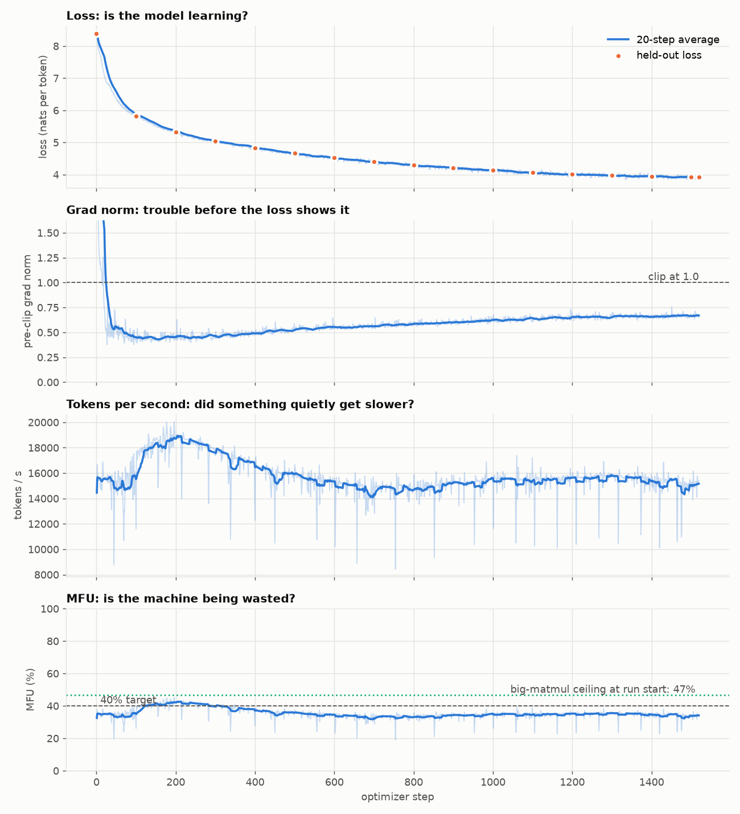
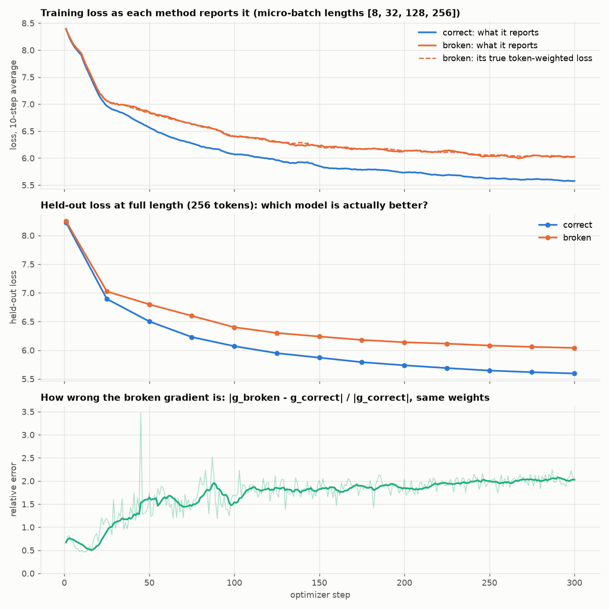
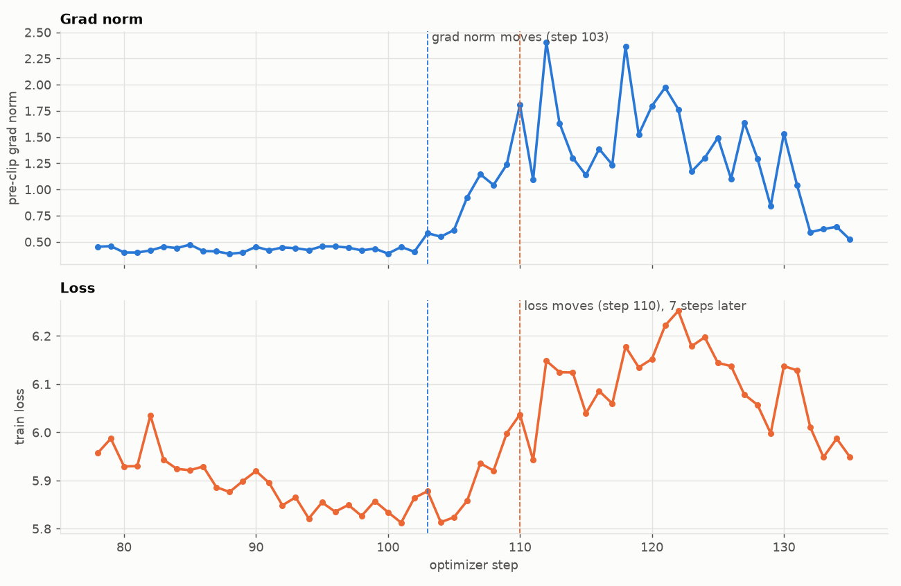
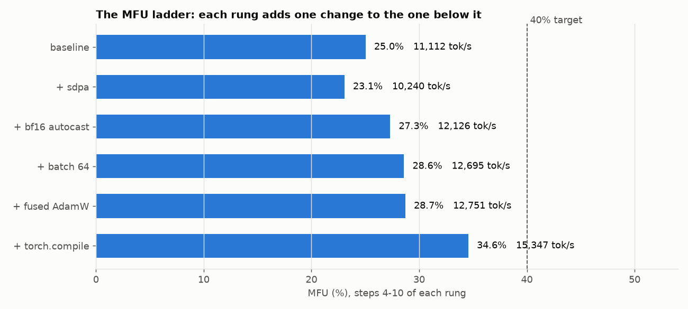

# The honest loop: train a small GPT and make it tell you the truth about itself

A step by step guide for someone who has never trained a model before.

You will train a small language model (12.3 million numbers) on educational web text, on a Mac with an Apple M4 chip. That part is ordinary. The point of this guide is everything around it: we make the training loop report on itself, and then we check its reports instead of trusting them. By the end you will have:

- printed every tensor in one training step and said what each of its dimensions means
- checked one gradient by hand, nudging a weight and measuring the loss, and found where that check breaks
- broken gradient accumulation on purpose and measured the damage
- watched the grad norm move before the loss did
- computed how much of the chip we actually use (MFU), and said what costs us the rest
- written the number 0.1 out bit by bit in six number formats, and picked one to train in

Along the way we found a bug in PyTorch's compiler that made one gradient 64 times too large while the loss looked perfectly healthy, and we watched a fanless laptop lose 46% of its speed to heat, in the tokens-per-second trace. Part 15 tells both stories. They are the best argument in this guide for checking things yourself.

You do not need to know machine learning. You need to be able to run commands in a terminal and read what comes back. Every term is explained the first time it appears, and there is a glossary at the end.

How to read this guide. Parts 1 to 10 are the "lecture": what each piece is, with small numbers you can check on paper. Parts 11 to 19 are the "lab": how to run it, how to read the output, and what our run actually measured. If you are impatient, jump to Part 11 and come back when an output confuses you. Part 8 (how computers store numbers) is the longest because it is the part most people skip and later regret.

All numbers in this guide come from one run of `pipeline.ipynb` on a MacBook Air M4 (8-core GPU, 16 GB), unless they are labelled as coming from an earlier test run. The notebook keeps its outputs, so you can check any number against the cell that printed it.

---

## Contents

**Lecture**

1. [What a language model does, and what a token is](#part-1-what-a-language-model-does-and-what-a-token-is)
2. [The training pipeline, end to end](#part-2-the-training-pipeline-end-to-end)
3. [Loss: the score we push down](#part-3-loss-the-score-we-push-down)
4. [Gradients and autograd, by hand](#part-4-gradients-and-autograd-by-hand)
5. [Tensor shapes: reading B, T, C, H, D, V](#part-5-tensor-shapes-reading-b-t-c-h-d-v)
6. [Gradient accumulation, and how to break it](#part-6-gradient-accumulation-and-how-to-break-it)
7. [Grad norm: the early warning](#part-7-grad-norm-the-early-warning)
8. [How computers store numbers](#part-8-how-computers-store-numbers)
9. [What a step costs in memory](#part-9-what-a-step-costs-in-memory)
10. [Speed: tokens per second, FLOPs and MFU](#part-10-speed-tokens-per-second-flops-and-mfu)

**Lab**

11. [Setting up on a Mac](#part-11-setting-up-on-a-mac)
12. [Running the notebook](#part-12-running-the-notebook)
13. [Moving to Kaggle](#part-13-moving-to-kaggle)
14. [Reading the four traces](#part-14-reading-the-four-traces)
15. [Results, and the honest MFU report](#part-15-results-and-the-honest-mfu-report)
16. [When things go wrong](#part-16-when-things-go-wrong)
17. [A tour of the code](#part-17-a-tour-of-the-code)
18. [Experiments to try next](#part-18-experiments-to-try-next)
19. [Glossary](#part-19-glossary)

---

## Part 1: What a language model does, and what a token is

### 1.1 The one job

A language model reads some text and guesses what comes next. That is the whole job. Give it "The capital of France is" and it returns a score for every possible next piece, which turns into a probability:

```
" Paris"     0.91
" a"         0.02
" located"   0.01
...          (4,000 more options, each tiny)
```

Chatbots, code assistants and translators are all this one guess, repeated: pick a piece, append it, guess again.

### 1.2 Tokens

The "pieces" are **tokens**. A token is a word, part of a word, a space plus a word, or a punctuation mark. The program that cuts text into tokens is the **tokenizer**, and every token has an ID number. Our tokenizer cuts a sentence like this (real output from `data.py`):

```
"The mitochondria is the powerhouse of the cell."

['The', 'Ġm', 'it', 'och', 'ond', 'ri', 'a', 'Ġis', 'Ġthe', 'Ġpower', 'h', 'ouse', 'Ġof', 'Ġthe', 'Ġcell', '.']
[451,   287,  274,  3675,  650,  396,  65,  310,   262,    1101,     72,  1188,   278,   262,    1073,    14]
```

`Ġ` is how this tokenizer writes "a space before this token". Common words (` the`, ` of`, ` is`) get one token each. A rare word like "mitochondria" gets chopped into six pieces.

Three facts to keep:

- The model never sees letters. It sees lists of ID numbers.
- Our tokenizer averages **3.43 characters per token** on this data.
- A tokenizer and a model belong together. Token 262 means " the" only for this tokenizer.

### 1.3 How the tokenizer was built: byte pair encoding

We trained our own tokenizer instead of borrowing one. It takes 2 seconds and makes the idea concrete. The method is **byte pair encoding (BPE)**:

1. Start with the 256 possible bytes as the vocabulary. Any text can be written with these, so nothing is ever "unknown".
2. Count every pair of neighbouring tokens in the training text. Find the most common pair, say `t` followed by `h`.
3. Add `th` to the vocabulary as a new token, and replace every `t h` in the text with `th`.
4. Repeat. Next might be `th` + `e` = `the`, then ` ` + `the` = ` the`.
5. Stop when the vocabulary reaches the size you want. We stop at **4,096**.

So the vocabulary is the 256 bytes, one special `<|endoftext|>` token that marks where one document ends and the next begins, and 3,839 learned merges.

Why 4,096 and not GPT-2's 50,257? Vocabulary size has a price in a small model. The last layer of the model produces one score per vocabulary entry, so its size is vocab x width. With GPT-2's vocabulary, that one layer would be 64% of all the computation in our model; with 4,096 it is 13%. A small vocabulary means more tokens per sentence (each token covers less text), but it leaves the compute for the parts of the model that do the thinking.

### 1.4 The data

The text is **FineWeb-Edu**, web pages filtered for educational value. `data.py` downloads 31,319 documents (153 million characters, about 45 seconds), then writes:

```
train.bin    25,000,000 tokens   (each token id is a 2-byte number, so 50 MB)
eval.bin        500,000 tokens   from the first 405 documents
```

The eval documents come first in the stream and are kept out of both tokenizer training and model training. When we measure the model on them, we measure it on text it has never seen. That is called **held-out** data.

---

## Part 2: The training pipeline, end to end

Here is one training step, top to bottom. Everything else in this guide zooms into one of these boxes.

```
 train.bin (25M token ids)
      |
      |  cut 64 windows of 257 consecutive tokens
      v
 batch: 64 x 257 ids
      |
      |  input  x = first 256 of each window      (64, 256)
      |  target y = the same window shifted by 1  (64, 256)
      v
 +-----------------------------+
 |  FORWARD PASS               |   ids -> vectors -> 6 transformer blocks -> scores
 |  logits: (64, 256, 4096)    |   one score per vocabulary entry, at every position
 +-----------------------------+
      |
      v
 LOSS = average of -log(probability given to the true next token)     one number
      |
      v
 +-----------------------------+
 |  BACKWARD PASS              |   for each of the 12.3M weights:
 |  gradients: same shapes as  |   "if this weight goes up a little,
 |  the weights                |    does the loss go up or down, and how fast?"
 +-----------------------------+
      |
      v
 GRAD NORM = size of all 12.3M gradients together        (log it, then clip it to 1.0)
      |
      v
 OPTIMIZER STEP (AdamW): nudge every weight a little against its gradient
      |
      v
 log one line: loss, grad norm, tokens per second, MFU          ...and repeat 1,519 times
```

The shift between x and y is the whole "predict the next token" task in one line of code. If a window is `[The, cat, sat, on, the, mat]`, then:

```
input:   The   cat   sat   on    the
target:  cat   sat   on    the   mat
```

At position 0 the model sees "The" and should predict "cat". At position 3 it sees "The cat sat on" and should predict "the". Each window of 256 inputs gives 256 predictions to grade, all computed at once.

The four numbers in the last box are the four **traces** we watch, every step:

| trace | what it catches |
|---|---|
| loss | whether the model is learning at all |
| grad norm | trouble, before the loss shows it |
| tokens per second | whether something quietly got slower |
| MFU | whether the machine is being wasted |

### 2.1 The model, in one paragraph

Our model is a **GPT**: a stack of identical **transformer blocks**. First, an **embedding table** turns each token id into a list of 384 numbers (a **vector**), and a second table adds a vector for the position (0 to 255). Then 6 blocks each do two things. **Attention** lets every position look back at earlier positions and pull in information ("the word 'it' here refers to 'the cat' 5 tokens back"). The **MLP** (a small two-layer network) then processes each position on its own. Each block adds its result to the running vector instead of replacing it; this running vector is the **residual stream**. At the end, the same embedding table, used in reverse, turns each final vector into 4,096 scores. Using one table for both ends is called **weight tying**.

| piece | parameters |
|---|---|
| token embedding (4,096 x 384), also the output layer | 1,572,864 |
| position embedding (256 x 384) | 98,304 |
| 6 blocks x 1,771,008 (attention 589,824 + MLP 1,179,648 + two LayerNorms 1,536) | 10,626,048 |
| final LayerNorm | 768 |
| **total, N** | **12,297,984** |

### 2.2 The architecture, box by box

Shapes use the letters from `model.py`: B = 64 sequences, T = 256 positions, C = 384 channels, H = 6 heads, D = 64 channels per head, V = 4,096 tokens. A line that skips down the left side of a box is a residual connection: the layer's output is added to the vector that went in.

```
 token ids                                                        (B, T)
      |
      v
 +---------------------------+     +---------------------------+
 | tok_emb   4,096 x 384     |     | pos_emb   256 x 384       |
 | id -> 384 numbers         |     | position -> 384 numbers   |
 +-------------+-------------+     +-------------+-------------+
               |                                 |
               +------------- add ---------------+
                               |
                               v                              (B, T, 384)
                    the residual stream starts here
                               |
 +-----------------------------+--------------------------------------------+
 |  BLOCK x 6   (same shape every time, separate weights each time)         |
 |                             |                                            |
 |                  +----------+-----------+                                |
 |                  |                      v                                |
 |                  |              LayerNorm  ln1                           |
 |                  |                      |                                |
 |                  |                      v                                |
 |                  |   +-------------------------------------+             |
 |                  |   | ATTENTION                           |             |
 |                  |   | qkv   384 -> 1,152   q, k, v        |             |
 |                  |   | split into 6 heads of 64            |             |
 |                  |   | softmax(Q K^T / 8) V, causal mask   |             |
 |                  |   | merge heads, proj   384 -> 384      |             |
 |                  |   +------------------+------------------+             |
 |                  |                      |                                |
 |                  +--------- (+) --------+              resid_after_attn  |
 |                              |                                           |
 |                  +-----------+----------+                                |
 |                  |                      v                                |
 |                  |              LayerNorm  ln2                           |
 |                  |                      |                                |
 |                  |                      v                                |
 |                  |   +-------------------------------------+             |
 |                  |   | MLP (each position on its own)      |             |
 |                  |   | fc     384 -> 1,536, then GELU      |             |
 |                  |   | proj 1,536 -> 384                   |             |
 |                  |   +------------------+------------------+             |
 |                  |                      |                                |
 |                  +--------- (+) --------+              resid_after_mlp   |
 |                              |                                           |
 +-----------------------------+--------------------------------------------+
                               |
                               v                              (B, T, 384)
                       LayerNorm  ln_f
                               |
                               v
                 +---------------------------+
                 | lm_head   384 -> 4,096    |   same matrix as tok_emb,
                 | (weight tying)            |   read the other way round
                 +-------------+-------------+
                               |
                               v
                logits                                       (B, T, 4,096)
                               |
                               v
         token_loss: cross-entropy against the true next ids    one number
```

Where each box lives in the code:

| box | what it does | parameters | code |
|---|---|---|---|
| tok_emb, pos_emb | look up a vector per token id and per position, add them | 1,572,864 + 98,304 | [model.py:162-163](model.py#L162-L163), used at [model.py:201-204](model.py#L201-L204) |
| LayerNorm ln1, ln2 | rescale each token vector to mean 0, spread 1, before each sub-layer | 768 each | [model.py:137](model.py#L137), [model.py:139](model.py#L139) |
| Attention | each position mixes in values from earlier positions | 589,824 | [model.py:56-105](model.py#L56-L105) |
| MLP | widen to 4C, GELU, narrow back | 1,179,648 | [model.py:108-125](model.py#L108-L125) |
| Block | the two residual additions | 1,771,008 | [model.py:128-148](model.py#L128-L148) |
| ln_f | final rescale | 768 | [model.py:165](model.py#L165), [model.py:210](model.py#L210) |
| lm_head | turn each vector into 4,096 scores, sharing tok_emb's weight | 0 extra | [model.py:166-167](model.py#L166-L167), [model.py:212](model.py#L212) |
| token_loss | cross-entropy in fp32 | none | [model.py:238-257](model.py#L238-L257) |

Where the pieces from Part 8 sit: the matmuls (`qkv`, `proj`, `fc`, `lm_head`) run in bf16 under autocast, set up at [train.py:298-300](train.py#L298-L300). The residual stream, LayerNorm and the loss stay in fp32. The shapes in the diagram are the ones `train.py --trace-shapes` writes to `shapes.txt` (Part 5).

---

## Part 3: Loss: the score we push down

How do we score a guess? For each position we look at the probability the model gave to the token that actually came next, and take the negative logarithm:

```
loss at one position = -ln(probability given to the correct next token)
```

| probability on the right token | loss |
|---|---|
| 1.00 (sure, and right) | 0.00 |
| 0.50 | 0.69 |
| 0.10 | 2.30 |
| 0.01 | 4.61 |
| 1/4,096 (a uniform guess over our vocabulary) | 8.32 |

The reported loss is the average over every position in the batch: 64 x 256 = 16,384 positions per step.

Three numbers make a loss curve readable:

- **8.32 is "knows nothing".** A model that spreads probability evenly over 4,096 tokens scores ln(4096) = 8.32. Our untrained model scores 8.40 on held-out text at step 0. It is slightly worse than uniform because its random starting weights make it confidently wrong about a few tokens.
- **Lower is better, and it is a log scale.** Going from 6 to 5 means the probability on the right token went from e^-6 = 0.25% to e^-5 = 0.67%, on average.
- **Perplexity = e^loss.** A loss of 4 is a perplexity of 55: the model is as unsure as if it were picking between 55 equally likely tokens. Out of 4,096, that is a lot of learning.

Why the logarithm, instead of just "fraction right"? Because it rewards being confident and right, punishes being confident and wrong, and gives a smooth number that changes a little whenever any probability changes a little. That smoothness is what makes gradients possible.

One practical detail: we compute the loss in fp32 (32-bit numbers) even when the rest of the model runs in bf16 (16-bit). The loss involves a softmax over 4,096 scores followed by a log, and 16-bit numbers lose too many digits there. Part 8 explains why.

---

## Part 4: Gradients and autograd, by hand

### 4.1 What a gradient is

Training means changing the 12.3 million weights so the loss goes down. For each weight, the **gradient** answers one question: if I raise this weight a tiny bit, how much does the loss change?

- gradient = +0.5: raising the weight by 0.001 raises the loss by about 0.0005. So lower this weight.
- gradient = -0.2: raising the weight by 0.001 lowers the loss by about 0.0002. So raise it.
- gradient = 0: this weight does not matter right now.

The **optimizer** then moves every weight a small step against its gradient. The step size is the **learning rate**. Do that a thousand times and the loss goes down.

### 4.2 A three-number model, by hand

You can compute a gradient with nothing but multiplication. Take the smallest possible "model": one weight w, one input x, one target y.

```
prediction  p = w * x
error       e = p - y
loss        L = e * e
```

Let w = 2, x = 3, y = 5.

**Forward** (compute the loss, left to right):

```
p = 2 * 3 = 6
e = 6 - 5 = 1
L = 1 * 1 = 1
```

**Backward** (compute the gradient, right to left, one link at a time). This is the **chain rule**: the effect of w on L is the effect of w on p, times the effect of p on e, times the effect of e on L.

```
dL/de = 2 * e = 2          (L = e^2, so its slope is 2e)
de/dp = 1                  (e = p - y, so e moves exactly as p moves)
dp/dw = x = 3              (p = w * x, so its slope with respect to w is x)

dL/dw = 2 * 1 * 3 = 6
```

**Check it by nudging.** Move w up and down by eps = 0.001 and measure:

```
w = 2.001:  p = 6.003,  e = 1.003,  L = 1.006009
w = 1.999:  p = 5.997,  e = 0.997,  L = 0.994009

numeric gradient = (1.006009 - 0.994009) / (2 * 0.001) = 0.012 / 0.002 = 6.000
```

The two methods agree. This "nudge and measure" method is the **central difference**. It needs two extra loss evaluations per weight, so it is far too slow for 12.3 million weights. But it is the perfect way to check the fast method on a handful of weights.

Notice something in the backward pass: computing `dp/dw` needed x, a value from the forward pass. Backward needs forward values, so the forward values must be kept in memory until backward runs. That single fact is why training uses so much more memory than just running a model. Part 9 counts it.

### 4.3 Autograd: the chain rule, automated

**Autograd** is PyTorch's machinery for doing 4.2 on millions of numbers. During the forward pass, every operation (multiply, add, softmax) records itself and keeps whatever inputs it will need later. When you call `loss.backward()`, PyTorch walks that record backwards and applies the chain rule at each step, exactly as we did by hand. At the end, every weight `p` has its gradient in `p.grad`, with the same shape as `p`.

### 4.4 Checking backward() on the real model

`gradcheck.py` does 4.2's check on the real 12.3M-weight model. It picks five single weights from different kinds of layers, nudges each one up and down, and compares the measured slope with what `backward()` put in `.grad`. It runs on the CPU in fp64 (64-bit numbers, about 16 significant digits), because the M4's GPU has no fp64.

Result (batch of 4 sequences x 64 tokens, eps = 1e-5):

| weight | autograd | numeric | relative error | digits that agree |
|---|---|---|---|---|
| tok_emb(1775, 5) | -0.007978404 | -0.007978404 | 2.9e-09 | 8.5 |
| pos_emb(3, 7) | -0.006719273 | -0.006719273 | 1.6e-08 | 7.8 |
| block 0 attention qkv(10, 20) | -0.000176871 | -0.000176871 | 2.9e-08 | 7.5 |
| block 3 MLP fc(100, 50) | -0.000743333 | -0.000743333 | 6.8e-08 | 7.2 |
| block 5 LayerNorm gain(17) | 0.000426888 | 0.000426888 | 1.7e-07 | 6.8 |

Seven to eight digits of agreement. backward() is telling the truth.

**Relative error** is `|numeric - autograd| / max(|numeric|, |autograd|)`. "Digits that agree" is `-log10(relative error)`: a relative error of 1e-8 means the first 8 significant digits match.

### 4.5 Where the check breaks, and why that is worth understanding

Now the same check in fp32, with eps = 0.001, which looks like a perfectly sensible choice:

| weight | autograd | numeric | relative error |
|---|---|---|---|
| tok_emb(1775, 5) | -0.007978383 | -0.008106232 | 1.6e-02 |
| pos_emb(3, 7) | -0.006719274 | -0.006675720 | 6.5e-03 |
| block 0 attention qkv(10, 20) | -0.000176871 | **+0.000476837** | 1.4 |
| block 3 MLP fc(100, 50) | -0.000743330 | -0.000953674 | 0.22 |
| block 5 LayerNorm gain(17) | 0.000426891 | **0.000000000** | 1.0 |

One numeric gradient has the wrong sign and one is exactly zero. Autograd did not break; its fp32 numbers match fp64 to 6 digits. The nudge method broke. Here is the whole explanation in one line that the script prints:

```
loss 8.4252: fp32 can resolve loss changes of about 1.0e-06; the nudges should move it by 3.5e-07 to 1.6e-05
```

An fp32 number carries about 7 significant digits. Near 8.4252, the gap between one fp32 number and the next is about 1e-6 (Part 8 shows why). Nudging the LayerNorm weight by 0.001 should change the loss by 2 x 0.001 x 0.000427 = 8.5e-7, less than one gap. So the loss before and after the nudge round to the same fp32 number, the difference is exactly 0, and the "gradient" is 0. For the attention weight the change is 3.5e-7, and what we measure is pure rounding noise, sign and all.

The **eps sweep** in `gradcheck.py` (and `plots/gradcheck.png`) shows the full picture for one weight:

- **eps too big** (1 to 0.01): the central difference is only an approximation. It assumes the loss is a straight line over the nudge, and over a big nudge it is not.
- **eps too small**: the loss change sinks below the rounding gap of the number format, and the measurement turns into noise.
- **fp64** has a wide valley between these, bottoming out at a relative error of 3e-9 near eps = 3e-5.
- **fp32** has a narrow valley, at best 7e-3 near eps = 0.1. Two digits.
- **bf16** has no valley at all. It cannot even store the nudge we ask for: asked to add 0.1 to a weight, it adds 0.100098, because that is the nearest bf16 number.

The lesson is not "fp32 is broken". fp32 is fine for training, because training never subtracts two nearly equal losses. The lesson is that a measurement has a resolution, and the number format sets it. When a check fails, ask first whether the instrument can see what you are measuring.

---

## Part 5: Tensor shapes: reading B, T, C, H, D, V

### 5.1 Tensors and shapes

A **tensor** is a grid of numbers. Its **shape** lists how long each side is. `(64, 256)` is a table with 64 rows and 256 columns. `(64, 256, 384)` is 64 tables of 256 rows x 384 columns.

Most bugs in model code are shape bugs, and almost every shape in a transformer is built from six letters:

| letter | name | our value | what it counts |
|---|---|---|---|
| B | batch | 64 | sequences processed side by side |
| T | time | 256 | token positions in a sequence |
| C | channels | 384 | numbers that represent one token (the model's width) |
| H | heads | 6 | independent attention patterns per layer |
| D | head dim | 64 | channels each head works with, C / H |
| V | vocab | 4,096 | possible tokens, one score each at the output |

### 5.2 One step, traced

`train.py --trace-shapes` records every tensor in a training step and writes `runs/shapes/shapes.txt`. Here is the forward pass, with a plain-words reading of each line:

```
input_ids               (64, 256)        int64     64 sequences of 256 token ids
tok_emb                 (64, 256, 384)   float32   each id looked up as a 384-wide vector
tok_emb + pos_emb       (64, 256, 384)   float32   plus a learned vector for each position
block0.attn.qkv         (64, 256, 1152)  bfloat16  query, key and value for every token: 3 x 384 = 1,152
block0.attn.q           (64, 6, 256, 64) bfloat16  queries split into 6 heads of 64 channels
block0.attn.heads_out   (64, 6, 256, 64) bfloat16  each head's weighted mix of values
block0.attn.merged      (64, 256, 384)   bfloat16  6 heads x 64 glued back into 384
block0.attn.out         (64, 256, 384)   bfloat16  after the output projection
block0.resid_after_attn (64, 256, 384)   float32   residual stream + attention's output
block0.mlp.hidden       (64, 256, 1536)  bfloat16  each token widened to 4 x 384 = 1,536, after GELU
block0.mlp.out          (64, 256, 384)   bfloat16  narrowed back to 384
block0.resid_after_mlp  (64, 256, 384)   float32   residual stream + MLP's output
block1 .. block5        (64, 256, 384)   float32   same shapes, five more times
ln_f                    (64, 256, 384)   float32   final LayerNorm
logits                  (64, 256, 4096)  bfloat16  a score for every vocab entry at every position
loss                    ()               float32   one number
```

Four things to notice:

1. **The (64, 256, 384) shape never changes between blocks.** That is what lets us stack 6 blocks, or 60. Each block reads a (B, T, C) tensor and writes one of the same shape.
2. **Attention reshapes (B, T, C) into (B, H, T, D).** The 384 channels get cut into 6 groups of 64, and the head axis moves to the front so each head can run as an independent (T, D) problem. Afterwards the heads are glued back. No numbers change during the reshape; only how they are grouped.
3. **The dtype column shows mixed precision at work.** Matmul outputs are `bfloat16` (autocast runs matrix multiplications in 16-bit). The residual stream, LayerNorm and the loss stay `float32`. Part 8 explains the split.
4. **The logits are the biggest tensor:** 64 x 256 x 4,096 = 67 million numbers. With GPT-2's 50,257-token vocabulary this one tensor would be 12 times bigger.

### 5.3 The backward pass and optimizer, traced

Every parameter gets a gradient of exactly its own shape and dtype:

```
tok_emb.weight.grad                (4096, 384)    float32   (V, C)
pos_emb.weight.grad                (256, 384)     float32   (context, C)
blocks.0.attn.qkv.weight.grad      (1152, 384)    float32   (3C, C)
blocks.0.attn.proj.weight.grad     (384, 384)     float32   (C, C)
blocks.0.mlp.fc.weight.grad        (1536, 384)    float32   (4C, C)
blocks.0.mlp.proj.weight.grad      (384, 1536)    float32   (C, 4C)
blocks.0.ln1.weight.grad           (384,)         float32   (C,)
...
```

PyTorch stores a linear layer's weight as **(out, in)**. The MLP's first layer maps 384 channels to 1,536, so its weight is (1536, 384). This trips up everyone once.

Then AdamW keeps two more tensors per parameter, again the same shape: `m`, a running average of recent gradients (which way have we been going?), and `v`, a running average of squared gradients (how big are the gradients usually?). AdamW divides one by the square root of the other, so every weight takes a step of roughly the same size, whether its gradients are big or tiny.

So each weight has **four** numbers living in memory during training: itself, its gradient, m and v. Part 9 turns that into megabytes.

---

## Part 6: Gradient accumulation, and how to break it

### 6.1 What accumulation is

Sometimes the batch you want does not fit in memory. **Gradient accumulation** splits it: run backward on several smaller **micro-batches** one after another, let the gradients add up in `.grad` (PyTorch adds by default), and take one optimizer step at the end. Done right, the step is identical to one big batch.

"Done right" is the whole problem.

### 6.2 The trap: an average of averages

The loss of a step should be the average over all the tokens in the step:

```
correct loss = (sum of every token's loss) / (total number of tokens)
```

The tempting shortcut is to compute each micro-batch's average loss, and average those:

```
broken loss = (average of micro-batch 1 + average of micro-batch 2 + ...) / K
```

When every micro-batch has the same number of tokens, the two are identical. When they differ, they are not. A tiny example with two micro-batches:

```
micro-batch A: 2 tokens, losses 4 and 6                   average 5
micro-batch B: 8 tokens, each loss 2                      average 2

correct: (4 + 6 + 8 x 2) / 10 tokens = 26 / 10 = 2.6
broken:  (5 + 2) / 2               = 3.5
```

The broken version counts each of A's 2 tokens as much as 4 of B's tokens. The two short-sequence tokens get to steer the gradient as much as all eight of B's.

When do micro-batches have different token counts in real life? Whenever sequences have different lengths: chat data, documents cut at their natural end, padding that gets masked out. Hugging Face's Trainer had this exact bug until October 2024, when it was found and fixed.

### 6.3 Our experiment

`accum.py` builds each step from 4 micro-batches of 16 sequences, with lengths 8, 32, 128 and 256 tokens (6,784 tokens per step), and computes how much weight a single token gets:

```
length  tokens    correct     broken  broken / correct
     8     128   1.47e-04   1.95e-03            13.25x
    32     512   1.47e-04   4.88e-04             3.31x
   128    2048   1.47e-04   1.22e-04             0.83x
   256    4096   1.47e-04   6.10e-05             0.41x
```

A token in the 8-token micro-batch counts 13 times more than it should. A token in the 256-token micro-batch counts less than half.

Here is a second way to see the damage. When weights are this uneven, the step behaves as if it had fewer tokens. Statisticians call this the **effective sample size**, `(sum of weights)^2 / (sum of squared weights)`. For the correct weighting it is all 6,784 tokens. For the broken weighting it is **1,524**. The broken run pays for 6,784 tokens per step and learns from about 22% of them. Worse, the tokens it over-weights are the first 8 positions of a sequence, where the model has almost no context to predict from. Those predictions are the least useful for a model that will be judged on full 256-token windows.

The script trains the same model twice, from the same starting weights, on the same data in the same order, 300 steps each. The only difference is the loss formula. In the correct run it also computes the broken gradient at the same weights, at every step, to measure how far apart they point. Part 15 has the results and the plot. As a preview: the two gradients have a cosine similarity of only about 0.5 (1.0 would mean the same direction), and the broken model ends clearly worse on held-out text.

### 6.4 The fix, in code

From `accum.py`:

```python
total_tokens = sum(y.numel() for _, y in micro_batches)
for x, y in micro_batches:
    loss_sum = token_loss(model(x), y, reduction="sum")   # add up, don't average
    (loss_sum / total_tokens).backward()                  # divide by the STEP's token count
```

Divide each micro-batch's summed loss by the token count of the whole step, not of the micro-batch. `train.py` does the same, even though its micro-batches all have equal length, so the code stays right if that ever changes.

---

## Part 7: Grad norm: the early warning

### 7.1 What it measures

The **grad norm** is the size of all 12.3 million gradient numbers taken together: square each one, add them all up, take the square root.

```
gradients (3, 4, 12)  ->  sqrt(9 + 16 + 144) = sqrt(169) = 13
```

It is the length of the gradient arrow, if you picture all 12.3 million numbers as one arrow in a 12.3-million-dimensional space. It says how steep the loss is at the current weights: how loudly the batch is telling the model to change.

### 7.2 Clipping

**Gradient clipping** puts a ceiling on that length. We use 1.0: if the grad norm comes out at 4.5, every gradient gets divided by 4.5, so the arrow keeps its direction but has length 1. A single weird batch then cannot shove the weights too far. In PyTorch:

```python
grad_norm = torch.nn.utils.clip_grad_norm_(model.parameters(), 1.0)
```

That call returns the norm **before** clipping, and that is the number we log. The clipped norm would be useless: it is at most 1.0 by construction.

### 7.3 Why it moves before the loss

This is the claim in the trace table, "grad norm catches trouble before the loss shows it". Why should that be true?

Picture the weights as a ball in a valley, and training as the ball stepping downhill. Near the bottom, a valley is shaped like a bowl: `height = x^2`, where x is the distance from the lowest point. The slope there is `2x`. Now suppose the learning rate is a bit too high, so the ball overshoots and starts bouncing from wall to wall, a little further out each time:

```
distance from bottom x:   0.10    0.20    0.30
height (loss):            0.01    0.04    0.09
slope (gradient):         0.20    0.40    0.60
```

Distance went from 0.1 to 0.3. The slope **tripled**. The height rose by **0.08**. On top of a real loss of 5.8, a rise of 0.08 is lost in the batch-to-batch noise, but a slope that triples is impossible to miss.

That is the mechanism. Near a minimum, loss grows with the square of the distance, so small errors barely show in it. The gradient grows in direct proportion to the distance, so it shows them straight away. By the time the loss is clearly rising, the bouncing has been growing for a while.

There is a second reason. The loss is one number averaged over 16,384 predictions; any 16,384 random tokens give a slightly different loss, so it wobbles from step to step. The grad norm also wobbles, but in a healthy run it drifts slowly, so a sudden change stands out against it.

### 7.4 What "moved first" means in numbers

"It moved" needs a definition, or any wiggle counts. `find_lead.py` scores each step against the 20 steps before it:

```
z = (value - median of the last 20 steps) / (1.4826 x median absolute deviation of the last 20 steps)
```

This is a **robust z-score**: how many "typical wiggles" above normal this step is. It uses the median and the median absolute deviation instead of the mean and standard deviation, so one wild step cannot inflate the baseline and hide the next one. (1.4826 scales the median absolute deviation so it matches a standard deviation for normally distributed noise.)

A grad-norm event is z > 4. A loss event is z > 4. A **lead** is a grad-norm event followed within 15 steps by a loss event, with the loss quiet just before the grad-norm event. Part 15 shows what we found: a sudden learning-rate spike moves both traces in the same step, while a gradual ramp produces a lead of several steps.

---

## Part 8: How computers store numbers

This part builds everything from zero: binary fractions, then the three fields every floating-point number has (sign, exponent, mantissa), then six real formats, with 0.1 worked through by hand in each. If you only half-follow it the first time, that is normal. Come back after Part 15 and it will land.

### 8.1 Binary, including the part after the point

In decimal, each digit is worth ten times the one to its right:

```
352.75 = 3x100 + 5x10 + 2x1 + 7x(1/10) + 5x(1/100)
```

Binary works the same way, with 2 instead of 10. Each bit is worth twice the one to its right, and after the point the bits are worth 1/2, 1/4, 1/8, 1/16 and so on:

```
110.101 (binary) = 1x4 + 1x2 + 0x1 + 1x(1/2) + 0x(1/4) + 1x(1/8)
                 = 4 + 2 + 0.5 + 0.125
                 = 6.625
```

### 8.2 Why 0.1 never ends in binary

To write a fraction in binary by hand, use the **doubling method**: double the number; if the result is 1 or more, write a 1 and subtract 1, otherwise write a 0. Repeat.

```
0.1 x 2 = 0.2   -> 0
0.2 x 2 = 0.4   -> 0
0.4 x 2 = 0.8   -> 0
0.8 x 2 = 1.6   -> 1, keep 0.6
0.6 x 2 = 1.2   -> 1, keep 0.2
0.2 x 2 = 0.4   -> 0     <- we have seen 0.2 before: the pattern repeats from here
0.4 x 2 = 0.8   -> 0
0.8 x 2 = 1.6   -> 1
0.6 x 2 = 1.2   -> 1
...

0.1 (decimal) = 0.0001100110011001100110011... (binary), with "0011" repeating forever
```

The same thing happens in decimal with 1/3 = 0.333... A fraction ends in base 10 only if its denominator is built from 2s and 5s. It ends in base 2 only if its denominator is a power of 2. 0.1 is 1/10, and 10 = 2 x 5, so in binary it never ends. Every format below has to cut it off somewhere, and where it cuts is the whole difference between them.

### 8.3 Scientific notation: the idea behind every float

In decimal scientific notation you write a number as "one digit, a point, some digits, times a power of ten":

```
6,020,000 = 6.02 x 10^6
0.000351  = 3.51 x 10^-4
```

The point "floats" to just after the first digit, and the power of ten says where it really belongs. That way you can write huge and tiny numbers with the same few digits.

Binary does the same with powers of two. Every nonzero binary number starts with a 1, so it can always be written as `1.something x 2^e`:

```
6.625 = 110.101 (binary) = 1.10101 x 2^2      (point moved 2 places left)
0.1   = 0.000110011...   = 1.10011001100... x 2^-4   (point moved 4 places right)
```

Check the second one in decimal: 0.1 = 1.6 x 2^-4 = 1.6 / 16. Yes.

### 8.4 Sign, exponent, mantissa

A floating-point number stores exactly three things from that form:

```
value = (-1)^sign  x  1.mantissa  x  2^(exponent - bias)
```

- **sign**: 1 bit. 0 means positive, 1 negative.
- **exponent**: a few bits holding the power of two. This sets the **range**: how big and how small the format can go.
- **mantissa** (also called the fraction or significand): the bits after the `1.`. This sets the **precision**: how many significant digits survive.

Two tricks make it compact:

1. **The leading 1 is not stored.** Every number in `1.something` form starts with 1, so storing it would waste a bit. This free bit is called the **hidden bit**. A format with 7 mantissa bits really has 8 bits of precision.
2. **The exponent is stored with a bias.** We need negative exponents (0.1 needs 2^-4), but the exponent field holds a plain positive number. So the format adds a fixed **bias** before storing: stored exponent = true exponent + bias. fp32's bias is 127, so 2^-4 is stored as -4 + 127 = 123, and 2^2 as 129.

Here is 6.625 in fp32, by hand:

```
6.625 = 1.10101 x 2^2
sign     = 0                                 (positive)
exponent = 2 + 127 = 129 = 10000001          (8 bits)
mantissa = 10101000000000000000000           (the bits after "1.", padded to 23)

bits: 0 | 10000001 | 10101000000000000000000
```

6.625 fits exactly, because its binary form ends after 5 bits. 0.1 will not.

### 8.5 The six formats

Every format below follows the same recipe. Only the bit budget changes.

```
format     sign  exponent  mantissa  bias   bits total
fp32         1       8        23      127      32
fp16         1       5        10       15      16
bf16         1       8         7      127      16
fp8 E4M3     1       4         3        7       8
fp8 E5M2     1       5         2       15       8
fp4 E2M1     1       2         1        1       4
```

"E4M3" just means 4 exponent bits and 3 mantissa bits. Read each format's name as its bit budget.

What the budget buys (from `fp_bits.py`):

| format | largest value | smallest normal | smallest subnormal | decimal digits |
|---|---|---|---|---|
| fp32 | 3.4 x 10^38 | 1.2 x 10^-38 | 1.4 x 10^-45 | ~7.2 |
| fp16 | 65,504 | 6.1 x 10^-5 | 6.0 x 10^-8 | ~3.3 |
| bf16 | 3.4 x 10^38 | 1.2 x 10^-38 | 9.2 x 10^-41 | ~2.4 |
| fp8 E4M3 | 448 | 0.0156 | 0.00195 | ~1.2 |
| fp8 E5M2 | 57,344 | 6.1 x 10^-5 | 1.5 x 10^-5 | ~0.9 |
| fp4 E2M1 | 6 | 1 | 0.5 | ~0.6 |

Read the table in two directions:

- **Exponent bits set the range.** bf16 has fp32's 8 exponent bits, so it reaches just as far: up to 10^38 and down to 10^-38. fp16 has 5 exponent bits, so it stops at 65,504 and can't go below about 6 x 10^-8.
- **Mantissa bits set the precision.** Each mantissa bit is worth about 0.3 decimal digits (log10(2) = 0.301), counting the hidden bit. fp32's 24 bits give about 7 digits; bf16's 8 bits give about 2.4.

bf16 and fp16 both spend 16 bits, but on opposite things. fp16 keeps more digits and gives up range. bf16 keeps fp32's range and gives up digits. That trade decides which one you can train in, as 8.9 shows.

### 8.6 0.1 by hand, in all six

All six start the same way:

```
0.1 = 1.6 x 2^-4
the bits after "1." (the 0.6 part): 1001 1001 1001 1001 1001 1001 1001 ...
```

Each format keeps as many of those bits as it has mantissa bits, then **rounds**: if the part cut off is more than half of the last kept bit's value, round up (add 1 to the last kept bit); if less, round down (just drop it). An exact half goes to whichever choice ends in 0; this is called "round half to even".

**fp32** (bias 127, 23 mantissa bits)

```
exponent: -4 + 127 = 123 = 01111011
mantissa: keep 23 bits  10011001100110011001100 | 1100...
          the cut-off part starts with 11..., more than half: round UP
          10011001100110011001100 + 1 = 10011001100110011001101

bits:    0 | 01111011 | 10011001100110011001101
stored:  0.100000001490116...       error +1.5 x 10^-9  (0.0000015%)
```

**fp16** (bias 15, 10 mantissa bits)

```
exponent: -4 + 15 = 11 = 01011
mantissa: keep 10 bits  1001100110 | 0110...
          the cut-off part starts with 01..., less than half: round DOWN

bits:    0 | 01011 | 1001100110
stored:  0.0999755859375            error -2.4 x 10^-5  (0.024%)
```

**bf16** (bias 127, 7 mantissa bits)

```
exponent: -4 + 127 = 123 = 01111011       (same as fp32: same exponent field)
mantissa: keep 7 bits  1001100 | 1100...
          more than half: round UP -> 1001101

bits:    0 | 01111011 | 1001101
stored:  1.6015625 x 2^-4 = 0.10009765625      error +9.8 x 10^-5  (0.098%)
```

bf16 is literally the top 16 bits of fp32, then rounded. Compare the two bit strings: `0 01111011 1001100...` is where they share their start.

**fp8 E4M3** (bias 7, 3 mantissa bits)

```
exponent: -4 + 7 = 3 = 0011
mantissa: keep 3 bits  100 | 1100...
          more than half: round UP -> 101

bits:    0 | 0011 | 101
stored:  1.625 x 2^-4 = 0.1015625      error +1.6 x 10^-3  (1.6%)
```

**fp8 E5M2** (bias 15, 2 mantissa bits)

```
exponent: -4 + 15 = 11 = 01011
mantissa: keep 2 bits  10 | 0110...
          less than half: round DOWN -> 10

bits:    0 | 01011 | 10
stored:  1.5 x 2^-4 = 0.09375          error -6.3 x 10^-3  (6.3%)
```

**fp4 E2M1** (bias 1, 1 mantissa bit)

fp4 has only 16 codes. Here are all 8 positive values:

```
code   0000  0001  0010  0011  0100  0101  0110  0111
value   0    0.5    1    1.5    2     3     4     6
```

The smallest nonzero value is 0.5. 0.1 is closer to 0 than to 0.5, so:

```
bits:    0 | 00 | 0
stored:  0                             error -0.1  (100%: the number is gone)
```

`fp_bits.py` does all six of these with exact fractions, then asks PyTorch to convert 0.1 and compares bit for bit. All five formats PyTorch can convert print `MATCH`. For fp4, which PyTorch only has as a packed type it can't convert to, the script lists all 16 codes and checks that the nearest one is the one we derived.

So how does anyone use fp4? Never alone. Formats like MXFP4 store a block of 32 fp4 numbers together with one shared scale factor, a power of two. To store 0.1, the block's scale might be 2^-4 = 1/16. Then 0.1 / (1/16) = 1.6, the nearest fp4 value is 1.5, and the stored number is 1.5 x 1/16 = 0.09375. That is the same 6% error as E5M2, at half the bits, as long as every number in the block has a similar size.

### 8.7 The gap between neighbours

Here is the single most useful idea in this part. A float format can't store every number, only a fixed set of them, and the **gap** between neighbouring numbers grows with the number's size.

Between 1 and 2, a format with m mantissa bits has 2^m evenly spaced numbers, so the gap is 2^-m. Between 2 and 4 the gap doubles, between 4 and 8 it doubles again, and so on.

| format | gap just above 1 | gap just above 8 |
|---|---|---|
| fp32 | 2^-23 = 1.2 x 10^-7 | 9.5 x 10^-7 |
| fp16 | 2^-10 = 0.00098 | 0.0078 |
| bf16 | 2^-7 = 0.0078 | 0.0625 |

Now Part 4.5's mystery is plain arithmetic. The loss was 8.4. In fp32 the gap near 8.4 is 9.5 x 10^-7, about 1e-6. Any loss change smaller than half of that rounds away.

The same arithmetic explains why we never store the weights themselves in bf16. Take a weight equal to 1.0 and an optimizer step of 0.001:

```
fp32:  1.0 + 0.001 = 1.00100004     (gap 1.2 x 10^-7, the step survives)
bf16:  1.0 + 0.001 = 1.0            (gap 0.0078: the step is less than half a gap, rounded away)
```

In bf16 that weight would never move, however many steps you took. Typical training updates are 1e-3 to 1e-5 of a weight's size. So even when the math runs in bf16, the weights stay in fp32. That fp32 original is called the **master copy** of the weights.

### 8.8 Underflow, overflow, and subnormals

Two ways a number falls off the edge of a format:

- **Overflow**: too big. fp16's largest value is 65,504, so 70,000 becomes infinity. One infinity in a sum makes the sum infinite, inf - inf is NaN ("not a number"), and NaN spreads through every calculation it touches. One overflow can kill a run.
- **Underflow**: too small. The number rounds to 0. A gradient that rounds to 0 just stops teaching.

Between the smallest normal number and zero, most formats have **subnormals**: when the exponent field is all zeros, the hidden bit becomes 0 instead of 1, and the format spreads a few extra values evenly down to zero. That is why fp16's smallest normal is 6.1 x 10^-5 but its smallest subnormal is 6.0 x 10^-8. Subnormals soften the edge; they do not remove it.

The comparison that decides between the 16-bit formats, printed by `fp_bits.py`:

```
a tiny gradient          1e-08   in fp16: 0 (underflow: the gradient is lost)
a tiny gradient          1e-08   in bf16: 1.00117e-08
a big activation         70000   in fp16: overflow -> inf
a big activation         70000   in bf16: 70144
```

Gradients of 1e-8 are common deep inside a network. Values of 70,000 show up in attention scores and in loss-scaled gradients. fp16 loses both. bf16 keeps both, slightly rounded (70144 instead of 70000 is a 0.2% error), and a slightly wrong number is far better than infinity or zero.

### 8.9 Loss scaling: how fp16 training survives

fp16's range problem has a standard workaround, and you will see it in this project on a T4. Multiply the loss by a big number S, say 65,536, before calling backward. Every gradient comes out S times bigger, which lifts the tiny ones out of the underflow zone. Before the optimizer step, divide them all by S again (in fp32, where that is safe). If some gradient overflowed to infinity, skip that step and halve S. If many steps pass without trouble, double S.

PyTorch's `GradScaler` does all of this. `train.py` turns it on automatically when the matmul dtype is fp16, which is what happens on a T4. With bf16 it is not needed: bf16 has fp32's range, so there is nothing to rescue.

### 8.10 fp8: two flavours for two jobs

fp8 is the newest training format. NVIDIA H100 and Ada GPUs (L4, RTX 40) have fp8 hardware; the T4 and the M4 do not. It comes in two flavours because 8 bits can't give enough range and enough precision at once:

- **E4M3**: more precision, max 448. Used for weights and activations in the forward pass, where values have a known, moderate size.
- **E5M2**: more range (max 57,344), almost no precision. Used for gradients, which span many orders of magnitude.

Even so, fp8 training only works with a **scale factor per tensor**. Each tensor is multiplied by a factor that brings its largest values near the top of the format's range, so the 8 bits are spent where the numbers actually are. Getting those factors right takes careful engineering.

### 8.11 Mixed precision: what actually runs in what

"Training in bf16" never means everything is bf16. Here is what our run does (you saw it in the shapes trace):

| thing | dtype | why |
|---|---|---|
| master weights | fp32 | updates of 0.001 must not round away (8.7) |
| matmul inputs and outputs | bf16 | half the bytes to move, faster on most hardware |
| residual stream | fp32 | a running sum over 6 blocks; small additions must survive |
| LayerNorm, softmax, loss | fp32 | sums and logs over many values lose digits in bf16 |
| gradients | fp32 | same dtype as the weight they belong to |
| AdamW state (m, v) | fp32 | v holds squared gradients, which can be very small |

PyTorch's **autocast** makes the split for you. Inside `with torch.autocast("mps", dtype=torch.bfloat16):`, each operation runs in the dtype PyTorch considers safe for it: matmuls in bf16, reductions and losses in fp32.

### 8.12 Which one I would train in, and why

**bf16 mixed precision**: bf16 for the matmuls, fp32 for the master weights, optimizer state, gradients, residual stream and loss. That is what this project's main run uses.

The reasons, in order of importance:

1. **Same range as fp32.** Nothing overflows at 70,000 and nothing underflows at 1e-8. No loss scaling, no skipped steps, no tuning of a scale factor. The most common way a 16-bit run dies simply does not exist.
2. **The lost precision does not hurt.** bf16 rounds each number by up to 0.4% (half its gap of 0.78%). But gradient descent is already noisy: two batches give gradients that differ far more than 0.4%. And every long sum (matmul accumulation, the residual stream, the loss, the weight update) happens in fp32, so rounding errors do not pile up.
3. **Half the bytes.** Every bf16 value is 2 bytes instead of 4, so activations take half the memory and half the memory traffic.
4. **Faster where there is hardware for it.** On NVIDIA Ampere and newer, bf16 tensor cores are 4 to 16 times faster than plain fp32 (L4: 121 against 30 TFLOPS; A100: 312 against 19.5). On the M4 the speed gain is small: we measured 2.84 TFLOPS for a big bf16 matmul against 2.60 for fp32, 9% more. The M4's GPU has no separate 16-bit matrix units. On the M4, bf16 mostly buys memory, not speed.

Why not the others:

- **fp32 everywhere**: always safe, but 2 times the activation memory and, on NVIDIA GPUs, up to 16 times slower matmuls. It is the right choice for checking things (like the gradient check), not for training.
- **fp16 mixed precision**: works, with loss scaling, and it is what you must use on a T4, which has fp16 tensor cores but no bf16. Its extra precision (3.3 digits against 2.4) is not worth the overflow and underflow risk when bf16 is available.
- **fp8**: about 2 times faster again on H100-class hardware, but it needs per-tensor scaling and careful monitoring, and neither of our machines has fp8 units. Use it for large runs on hardware built for it, after the bf16 version works.
- **fp4**: inference and the newest training research only, and only with block scaling (8.6). As 8.6 showed, alone it can't even store 0.1.

---

## Part 9: What a step costs in memory

### 9.1 The bill per weight

Part 5 ended with four numbers living in memory for every weight. In bytes:

| item | dtype | bytes per weight | for our 12,297,984 weights |
|---|---|---|---|
| the weight itself (the fp32 master copy) | fp32 | 4 | 49.2 MB |
| its gradient | fp32 | 4 | 49.2 MB |
| AdamW's m (running mean of gradients) | fp32 | 4 | 49.2 MB |
| AdamW's v (running mean of squared gradients) | fp32 | 4 | 49.2 MB |
| **total** | | **16** | **196.8 MB** |

Plus one more item that mixed precision adds: autocast makes a bf16 copy of each matmul weight during the forward pass (2 bytes per weight) and keeps it for backward. That is 24.4 MB for us.

16 bytes per weight is the number to remember. It is why training needs about 4 times the memory of just storing the model, before counting a single activation. Scale it up and you see why big models need many GPUs: a 7-billion-weight model needs 7 x 10^9 x 16 = 112 GB for weights, gradients and AdamW state alone, more than an 80 GB H100 holds.

### 9.2 Activations: the part that grows with the batch

Part 4.2 showed that backward needs values from the forward pass. Every operation keeps what it will need: a matmul keeps its input, GELU keeps its input, softmax keeps its output, and so on. These saved values are the **activations**, and unlike the weights, they grow with the batch: twice the sequences, twice the activations.

`flops.py` has a textbook estimate. It assumes attention runs as one fused kernel that never stores the (T x T) score matrix (true on recent NVIDIA GPUs) and counts the big tensors each block saves. At B = 64, T = 256:

```
weights (fp32)                 49.2 MB
gradients (fp32)               49.2 MB
AdamW state (fp32)             98.4 MB
bf16 weight copies             24.4 MB
activations, blocks          1361.3 MB   6 blocks x tensors saved for backward
activations, loss             268.4 MB   fp32 log-probabilities kept by cross-entropy
total                        1850.9 MB
```

So at this batch size the activations (1.6 GB) dwarf the weights and optimizer (0.2 GB). That is normal for small models with big batches.

### 9.3 What autograd actually saved

Estimates are guesses. PyTorch can tell us exactly what it keeps: `torch.autograd.graph.saved_tensors_hooks` lets us watch every tensor autograd saves during the forward pass. `flops.saved_tensors()` wraps that, and `train.py` prints the result on step 2. From the notebook's cell 4:

```
What autograd actually saved for backward: 2522.0 MB
     604.0 MB    6 x (64, 6, 256, 256)    float32     <- not in the textbook estimate
     604.0 MB   12 x (64, 256, 1536)      bfloat16    MLP hidden, before and after GELU
     327.2 MB   13 x (64, 256, 384)       float32     residual stream going into each LayerNorm
     302.0 MB   12 x (384, 256, 64)       float32     <- queries and values, in fp32
     268.4 MB    1 x (16384, 4096)        float32     log-probabilities for the loss
     239.1 MB   19 x (64, 256, 384)       bfloat16    LayerNorm outputs, merged heads
     151.0 MB    6 x (384, 64, 256)       float32     <- keys, transposed, in fp32
       ...
```

The textbook said 1.85 GB in total; autograd's list alone is 2.52 GB. Read the shapes, and the 670 MB gap has one cause.

**(64, 6, 256, 256) in float32** is the full attention matrix: for every sequence (64) and head (6), how much each of 256 positions attends to each of 256 positions. A fused attention kernel never stores it. Here it is stored, 6 times (once per layer), in fp32. And **(384, 256, 64) in float32** is (B x H, T, D): the queries, keys and values, upcast from bf16 to fp32.

So on Apple GPUs, PyTorch's `scaled_dot_product_attention` does not use a fused kernel. It falls back to the plain textbook math, softmax(QK^T)V, in fp32. That is also why the ladder (Part 15) shows no speed gain from switching to it: it is the same computation as our hand-written version. Nobody told us this. The memory bill did.

### 9.4 Checking against the device

The last check is the GPU's own count of bytes held by tensors (`torch.mps.current_allocated_memory()`), measured at three points in step 2:

```
before forward      283.3 MB   weights + AdamW state
after forward      2810.5 MB   + activations saved for backward
after backward      333.3 MB   activations freed, gradients added
```

Two of the three balance:

- after forward - before forward = 2,527 MB, against 2,522 MB in autograd's list. Within 0.2%.
- after backward - before forward = 50 MB, exactly the gradients (49.2 MB).

The first does not. Weights plus AdamW state are 147.6 MB, but the device holds 283.3 MB. The missing 135.7 MB is almost exactly one tensor: the logits, 64 x 256 x 4,096 numbers x 2 bytes (bf16) = 134.2 MB. After the previous step's backward pass, the Python variable `logits` still pointed at that tensor, so it stayed alive into the next step, sitting on top of the new forward pass and raising peak memory by 134 MB. The fix is one line in `train.py`:

```python
del logits, loss_sum, loss    # after backward: free this step's 134 MB of logits now
```

The provoked runs in the notebook (cell 10b) ran on the fixed code. Their memory bill shows `before forward 149.2 MB`, which is weights plus AdamW state plus about 1.5 MB of small tensors. That is what checking a prediction against a measurement is for: when they disagree, you find something.

Those runs also use torch.compile, and their saved list is 2,296 MB instead of 2,522. The whole 226 MB difference is queries, keys and values: compile keeps them in bf16 (227 MB) instead of upcasting them to fp32 (453 MB). The attention matrix is still there, still in fp32.

---

## Part 10: Speed: tokens per second, FLOPs and MFU

### 10.1 Tokens per second, measured honestly

The simplest speed number is **tokens per second**: tokens in a step divided by the step's time. Our steps hold 16,384 tokens, so a 1.05-second step (typical in our main run) is about 15,600 tokens per second.

Timing a GPU has one trap. When Python tells the GPU to do something, the call returns immediately and the work runs later; the GPU keeps a queue. Time a step without waiting and you measure how fast Python filled the queue, not how fast the GPU emptied it. So `train.py` calls `flops.sync(dev)` (wait until the GPU is idle) right before starting the clock and right before stopping it.

The other trap is counting things that are not training. Every 100 steps we run a held-out evaluation, and every 10 minutes we save a checkpoint. Both happen outside the timed region, so they never show up as a fake slowdown in the tokens-per-second trace. (The a14-MOE project counted eval time inside its step timing, which is why its log shows a dip at step 110 that was not a real slowdown.)

### 10.2 FLOPs

A **FLOP** is one floating-point operation: one multiply or one add. **FLOPS** (with a capital S) is FLOPs per second, the speed of a chip. A **TFLOPS** is 10^12 of them per second.

Nearly all of a transformer's work is matrix multiplication. Multiplying an (m x k) matrix by a (k x n) matrix takes m x k x n multiplies and about as many adds:

```
FLOPs of a matmul = 2 x m x k x n
```

### 10.3 The 6N rule

How many FLOPs does one token cost? Take one linear layer with a weight of shape (out, in), applied to one token's vector.

- **Forward:** each weight is used once: one multiply, one add. That is **2 FLOPs per weight**.
- **Backward:** two matmuls of the same size. One computes the gradient for the layer's input (to pass further back), the other computes the gradient for the weights. That is **4 FLOPs per weight**.

Total: **6 FLOPs per weight per token**. For a model with N weights:

```
FLOPs per token (forward + backward) = 6 x N
```

For us: 6 x 12,297,984 = **73.8 million FLOPs per token**, and 73.8M x 16,384 tokens = **1.21 TFLOPs per step**. Check one layer by hand: the MLP's first layer has 384 x 1,536 = 589,824 weights, so it costs 6 x 589,824 = 3.5 million FLOPs per token.

What 6N leaves out:

- **Attention's own matmuls.** Computing the query-key scores and the weighted sum of values multiplies activations by activations; no weights are involved, so 6N does not see them. They cost 12 x L x T x C = 12 x 6 x 256 x 384 = 7.1 million FLOPs per token (forward plus backward), about **9.6%** on top of 6N at our context length. This share grows with context length.
- **Elementwise work.** LayerNorm, GELU, softmax and the residual adds cost few FLOPs, but they read and write whole tensors. Their cost is time, not FLOPs, and 10.7 explains why that matters.
- **The embedding lookup** is a table read, not a matmul. The same table is also the output layer, which is a real matmul, and N counts that table once. That is the right count: once as compute, zero as lookup.

So 6N slightly undercounts the work the chip really does. That makes MFU a conservative number: it measures the *useful* work, by a fixed rule anyone can reproduce.

### 10.4 MFU

**MFU**, or model FLOPs utilization, asks what fraction of the machine we are genuinely using:

```
          6 x N x tokens per second
MFU  =  ------------------------------
         what the machine can do per second (its peak FLOPS)
```

A worked example with our main run's median speed, 15,564 tokens per second:

```
6 x 12,297,984 x 15,564 = 1.15 x 10^12 FLOPs per second of useful work
1.15 TFLOPS / 3.28 TFLOPS peak = 35%
```

Large training runs on NVIDIA hardware usually land between 30% and 50%. "40%" is the round number people quote as good.

### 10.5 The peak, and how sure we are of it

The denominator needs the chip's peak FLOPS. For NVIDIA chips it is printed on the datasheet; `flops.py` keeps a table (T4: 65 TFLOPS in fp16, A100: 312 in bf16, and so on).

Apple publishes no such number, so we derive one:

```
peak = GPU cores x ALUs per core x 2 FLOPs per fused multiply-add x clock
     =     8     x      128       x              2               x 1.6 GHz
     = 3.28 TFLOPS
```

An **ALU** is one arithmetic unit; each can do one **fused multiply-add** (a x b + c, counted as 2 FLOPs) per clock tick. The core count (8) comes from macOS itself (`system_profiler`). The ALUs per core (128) and the clock (about 1.6 GHz) come from people who measured the chip, not from Apple. So 3.28 TFLOPS is an **estimate**, and every MFU number in this project inherits its uncertainty. If the true clock were 1.8 GHz, every MFU here would drop by about 11%.

To have something firmer next to it, we also measure a **practical ceiling**: how fast one big 4096 x 4096 matmul runs. That is about as friendly a job as a GPU ever gets, so nothing real will beat it. On a cool M4 it reaches **2.8 TFLOPS**, 86% of the estimated peak. On a hot one it drops a lot, and Part 15 shows how much. `train.py` logs both: MFU against the 3.28 estimate, and the fraction of the measured ceiling.

### 10.6 Why a T4 changes the picture

On the M4, fp32 and bf16 run at about the same speed (2.60 against 2.84 TFLOPS in our matmul test), because Apple's GPU has no separate 16-bit matrix units. An NVIDIA T4 does: **tensor cores**, special units that multiply small 16-bit matrices in one go. The T4's datasheet says 8.1 TFLOPS in fp32 and **65 TFLOPS** in fp16, 8 times more.

That makes 40% MFU a much harder target on a T4. 40% of 65 TFLOPS is 26 TFLOPS of useful work, which for our model means about 350,000 tokens per second, 14 times what the M4 does when cool and 23 times what it sustained in our run. Tensor cores only reach their peak on large matrices with enough work to hide the time spent fetching data, and our matrices are 384 wide. We did not run on a T4, so this guide quotes no T4 MFU. If you run the notebook on Kaggle, expect a much lower MFU than on the M4 and a higher tokens per second, and Part 13 explains how to read that.

### 10.7 What eats MFU

If the chip can do 3.28 TFLOPS and our step needs 1.21 TFLOPs, why does a step take 1.05 seconds in our main run (0.64 on a cool chip) instead of 0.37? Because the GPU spends time on things that are not useful FLOPs:

1. **Moving memory instead of computing.** LayerNorm, GELU, softmax and the residual adds each read a whole (64, 256, 384) tensor from memory and write one back, while doing only a handful of FLOPs per number. The GPU's arithmetic units sit idle while the data travels. These operations are called **memory-bound**. A matmul is the opposite (**compute-bound**): it does hundreds of FLOPs for every number it reads.
2. **Kernel launches.** Each operation is a separate GPU program, a **kernel**. Launching one costs a few microseconds whatever its size, and a step launches hundreds.
3. **Small matrices.** A (16,384 x 384) by (384 x 1,152) matmul is small by GPU standards, and small matmuls run further below the chip's peak than big ones.
4. **Work 6N does not count.** Attention's score matmuls (10.3), and on the M4 the fact that attention runs in fp32 (Part 9).
5. **Heat.** A fanless laptop slows its own clock under sustained load. That takes speed away from everything at once, and it turned out to be our biggest cost by far (Part 15).
6. **The optimizer step.** AdamW reads and writes four fp32 numbers for each of the 12.3M weights every step. It is all memory traffic and no "useful" FLOPs.

The **MFU ladder** (`ladder.py`) tests these one at a time. Each rung adds one change and measures what it buys: PyTorch's fused attention kernel, bf16, a 4 times bigger batch (bigger matmuls, fewer launches per token), fused AdamW (the optimizer as one kernel), and **torch.compile**, which rewrites the model so that chains of small elementwise operations run as one fused kernel, reading the data once instead of five times. Part 15 has the measured results.

---

## Part 11: Setting up on a Mac

You need a Mac with an Apple Silicon chip (M1 or later; the numbers here are from an M4) and about 1 GB of free disk.

**1. Install uv**, a fast Python package manager, if you don't have it:

```bash
curl -LsSf https://astral.sh/uv/install.sh | sh
```

**2. Install the project's packages.** From the project folder:

```bash
cd a10-pipeline
uv sync
```

This reads `pyproject.toml`, creates a `.venv` folder with Python 3.12, and installs torch, tokenizers, numpy, matplotlib, pyarrow and huggingface-hub, plus Jupyter for the notebook.

**3. Check that PyTorch sees the GPU:**

```bash
uv run python -c "import torch; print(torch.__version__, torch.backends.mps.is_available())"
```

You want `True`. **MPS** (Metal Performance Shaders) is Apple's name for the GPU backend in PyTorch. If it prints `False`, you are on an Intel Mac or a very old macOS, and everything will run on the CPU, much more slowly.

**4. Open the notebook.** Either in VS Code (open `pipeline.ipynb` and pick `.venv/bin/python` as the kernel), or in the browser:

```bash
uv run jupyter notebook pipeline.ipynb
```

(`uv sync` installs `nbconvert` and `ipykernel`; if `jupyter notebook` is missing, add it with `uv add --dev notebook`.)

**Before a long run:** plug in the power cable and turn off Low Power Mode. A fanless MacBook Air slows its chip down when it gets hot (thermal throttling), and you will see that in the tokens-per-second trace as a slow drift downwards. That is exactly the kind of quiet slowdown the trace is there to catch.

---

## Part 12: Running the notebook

`pipeline.ipynb` runs every experiment in order. Every code cell has a markdown cell above it that says what it does, what to expect, and how to read the output. Run it top to bottom with "Run All", or cell by cell to read as you go. The whole thing took about 60 minutes on our M4, slower than planned because the chip heated up (Part 14.3).

| cell | runs | time on M4 | read about it in |
|---|---|---|---|
| 1 | setup, device check | seconds | Part 11 |
| 2 | `data.py`: download, tokenizer, token files | ~1 min | Part 1 |
| 3 | decode the first 40 training tokens | seconds | Part 1 |
| 4 | `train.py --trace-shapes`: every tensor, memory bill | ~20 s | Parts 5, 9 |
| 5 | `gradcheck.py` and its plot | ~1 min | Part 4 |
| 6 | `fp_bits.py`: 0.1 in six formats | seconds | Part 8 |
| 7 | `accum.py` and its plot | ~8 min | Part 6 |
| 8 | `ladder.py` and its plot | ~3 min | Parts 10, 15 |
| 9 | the main run | ~30 min | Parts 14, 15 |
| 9b | the four-trace plot | seconds | Part 14 |
| 10 | `find_lead.py` on the main run | seconds | Part 7 |
| 10b | provoked spike and ramp runs, lead plot | ~4 min | Parts 7, 15 |
| 11 | the MFU summary | seconds | Part 15 |

Every script also runs on its own from the terminal, with `uv run`. Each one's usage is at the top of its file. For example:

```bash
uv run train.py --data data/fwe --out runs/main --compile --fused-adam
uv run plot.py --main runs/main --out plots
```

The files a run leaves behind:

```
data/fwe/                train.bin, eval.bin, tokenizer.json, meta.json
runs/shapes/shapes.txt   every tensor in one step
runs/gradcheck.json      the hand-checked gradients and the eps sweep
runs/accum/              correct.jsonl, broken.jsonl
runs/ladder.json         the MFU ladder
runs/main/               metrics.jsonl (one line per step), config.json, ckpt.pt, sample.txt
runs/spike/, runs/ramp/  the provoked grad-norm runs, with lead.json
plots/                   trace.png, accum.png, ladder.png, gradcheck.png, lead.png
```

One line of `metrics.jsonl` looks like this:

```json
{"type": "train", "step": 812, "tokens": 13303808, "loss": 4.2416, "grad_norm": 0.5878,
 "lr": 0.000525, "step_time": 1.068, "tok_per_s": 15346.8, "mfu": 0.3456, "ceiling_frac": 0.7412}
```

(Step 812 of our main run, rounded. The file stores full precision.)

`ceiling_frac` is the same calculation as `mfu`, but against the measured matmul ceiling instead of the estimated peak.

---

## Part 13: Moving to Kaggle

The same notebook runs on Kaggle's free T4 GPU. The scripts detect the device and adjust: on a T4 they run matmuls in fp16 (the T4 has no fast bf16) and switch on loss scaling (Part 8.9).

**1. Make a dataset with the code.** On kaggle.com: Datasets, New Dataset, upload the `.py` files (`data.py`, `model.py`, `flops.py`, `train.py`, `gradcheck.py`, `accum.py`, `fp_bits.py`, `ladder.py`, `find_lead.py`, `plot.py`). Name it `honest-loop`.

**2. Import the notebook.** Create a new notebook, then File, Import Notebook, and pick `pipeline.ipynb`.

**3. Attach the dataset and a GPU.** In the right sidebar: Add Input, find `honest-loop`. Under Settings: Accelerator, GPU T4 x2 (the scripts use one of the two), and turn Internet on, because `data.py` downloads FineWeb-Edu.

**4. Run All.** Cell 1 copies the scripts from `/kaggle/input/honest-loop` into `/kaggle/working` and installs `tokenizers`. Everything after that is unchanged.

What changes on a T4, and what to look for:

| | M4 (measured) | T4 (what to expect) |
|---|---|---|
| matmul dtype | bf16 | fp16 with GradScaler |
| peak in the MFU formula | 3.28 TFLOPS (estimate) | 65 TFLOPS (fp16 datasheet) |
| PyTorch attention kernel | plain-math fallback in fp32 | a real fused kernel |
| torch.compile | works, with our workaround (Part 15) | works, uses Triton kernels |

Expect tokens per second to go up and MFU to go down. A higher speed and a lower MFU are not a contradiction: the denominator grew 20 times. If the `compile check` line prints a difference above 1% on the T4, the script stops; rerun the cell without `--compile` and note it.

Kaggle sessions have time limits and can disconnect. `train.py` saves `runs/main/ckpt.pt` every 10 minutes, and `--resume` continues from it. Download `runs/` and `plots/` from the output panel before the session ends.

---

## Part 14: Reading the four traces



`plots/trace.png` has one panel per trace, all sharing the step axis. Pale lines are the raw per-step values; the solid line is a 20-step average. Here is how to read each one, using our run.

### 14.1 Loss: is the model learning?

The orange dots are held-out losses, every 100 steps:

| step | 0 | 100 | 200 | 300 | 500 | 800 | 1000 | 1200 | 1519 |
|---|---|---|---|---|---|---|---|---|---|
| held-out loss | 8.396 | 5.825 | 5.322 | 5.044 | 4.659 | 4.303 | 4.132 | 4.015 | 3.925 |

What a healthy curve looks like, and this one does:

- **A steep drop first.** From 8.40 to 5.83 in 100 steps. The model first learns which tokens are common at all (" the", ",", " of"), which is easy and worth a lot of loss.
- **Then a long, slowing slope.** 5.83 to 3.93 over the next 1,419 steps. Each further gain needs real patterns: grammar, which words go together.
- **Train and held-out agree.** The blue line runs through the orange dots. If train loss kept falling while held-out loss flattened or rose, the model would be memorizing its training text (overfitting). With 25M tokens seen once each, there is nothing to memorize.

A final loss of 3.925 is a perplexity of e^3.925 = 51: on average the model is as unsure as if choosing between 51 tokens, out of 4,096. The 200-token sample at the end of the run shows what that buys:

```
The most important thing about learning is a few kind of information related to your students's
development and caregivers is an example of your research.
...
One of the most important ways to work with a classes of learning is to teach students, and
students learn more about the classroom and their learning experience.
```

Grammatical pieces, on-topic vocabulary (it learned that FineWeb-Edu is full of schools and students), no meaning across sentences. That is about what 12M weights and 25M tokens can do.

### 14.2 Grad norm: trouble before the loss shows it

- **Steps 1 to 30: big and falling.** It starts at 4.46 (above the clip line, so those steps get clipped) and drops below 1 within 25 steps. At random initialization every weight is wrong, so the loss is steep everywhere.
- **Then a slow, steady rise**, from about 0.46 around step 250 to 0.67 at the end. The rise is smooth, with no jumps, and the loss keeps falling throughout. A slow rise like this is common in runs with weight decay and a decaying learning rate. It is not trouble.
- **What trouble would look like:** a sudden jump of several times its recent level, or a sustained climb while the loss is flat. `find_lead.py` found no such step in this run (Part 15.4). A calm grad norm is the good outcome.

### 14.3 Tokens per second: did something quietly get slower?

Yes, and this panel caught it.

- **Steps 1 to 100: about 15,500.**
- **Steps 100 to 300: up to about 18,500.** Something outside the run eased off for a while; the run itself cannot see what.
- **Steps 300 to 700: a slide down to about 14,700**, then a plateau around 15,400 for the rest of the run.

Nothing in the code changed during the run. What changed was the chip. This MacBook Air (model Mac16,12) has no fan, so under sustained load it slows its clock to stay cool. The evidence is in the notebook: the same 4096 x 4096 matmul ran at **2.81 TFLOPS** in cell 4, at the start, and at **1.53 TFLOPS** when the main run started, after about 12 minutes of gradcheck, accumulation and ladder work. Same code, same chip, 46% slower.

The sharp single-step dips (down to 9,000 to 12,000) are something else. They hit isolated steps about once a minute (steps 400, 450, 556, 602, 657, ...), they do not line up with eval steps, and they do not move the median. Something else on the machine took the GPU for a moment; Docker and other apps were running. A real slowdown shows up in the solid line, not in single spikes.

### 14.4 MFU: is the machine being wasted?

MFU is tokens per second times a constant (6N / peak), so this panel has exactly the same shape as the one above, rescaled. The dashed line is the 40% target. The dotted line is the big-matmul ceiling at the start of this run: 1.53 / 3.28 = 47%. That line is the most a real kernel could get out of the chip in its heated state. Part 15 puts numbers on all of this.

---

## Part 15: Results, and the honest MFU report

### 15.1 What we ran

| | |
|---|---|
| Model | GPT, 6 layers, width 384, 6 heads, context 256, tied embeddings, 12,297,984 parameters |
| Data | FineWeb-Edu, 25M train tokens, 0.5M held-out tokens, our own 4,096-token BPE |
| Hardware | MacBook Air M4 (8-core GPU, 16 GB), PyTorch 2.15, MPS |
| Precision | bf16 autocast, fp32 master weights and optimizer state |
| Batch | 64 sequences x 256 tokens = 16,384 tokens per step, 1,519 steps (24.9M tokens) |
| Optimizer | AdamW, lr 1e-3, betas (0.9, 0.95), 50 warmup steps, cosine to 1e-4, weight decay 0.1, clip 1.0 |
| Speed settings | fused AdamW, torch.compile (the ladder's top rung) |
| Time | 26.6 minutes of timed training steps, plus the held-out evals every 100 steps |

### 15.2 The gradient check

backward() agrees with the hand-measured gradient to 6.8 to 8.5 digits in fp64 (Part 4.4). In fp32 with eps = 0.001 the hand measurement breaks down, because the loss changes we try to measure (as small as 3.5e-7) are smaller than fp32's gap near a loss of 8.4 (about 1e-6). The eps sweep shows fp64 is best near eps = 3e-5 (relative error 2.6e-9), fp32 near eps = 0.1 (7e-3), and bf16 has no usable eps at all.

### 15.3 Breaking gradient accumulation



| after 300 steps | correct | broken |
|---|---|---|
| held-out loss (full 256-token windows) | **5.595** | **6.041** |
| what the method reports as its training loss (last step) | 5.625 | 6.062 |
| its true token-weighted training loss (last step) | 5.625 | 6.077 |

The broken run ends **0.45 nats worse** on held-out text. To put that in steps: the correct run passed 6.04 at about step 105, so after 300 steps the broken run is where the correct one was after about a third of the training.

The bottom panel is the more direct evidence. At the same weights, the broken gradient differs from the correct one by a relative error of 0.5 at the start, rising to about 2.0 (median 1.84). The cosine similarity between the two falls from 0.84 at step 1 to about 0.47 at step 300. Two arrows with cosine 0.47 point about 60 degrees apart. The error grows as training goes on; this experiment shows that it does, not why.

Notice also what the top panel shows: the broken run's reported loss and its true token-weighted loss are nearly the same line here, and both sit above the correct run. Our sequences come from the same text, so the bug did not disguise itself in the logged loss; it just made the model learn worse. In real data, where short sequences can be systematically easier or harder than long ones, the reported number can be off too, and then the bug hides in plain sight.

### 15.4 Grad norm before loss

The main run was calm: `find_lead.py` found **no** step where the grad norm jumped (z > 4) and the loss followed. That is a result, not a failure: a healthy run should not have one.

So we provoked two, in 150 and 200-step side runs of the same model (cell 10b). Both are labelled as provoked:

**Spike: learning rate x10 for 5 steps, from step 100.**

```
step   loss     grad norm
 100   5.8442   0.390
 101   5.8208   0.414
 102   6.1488   1.182      <- both jump in the same step
 103   6.9298   3.672
 104   8.6586   4.601
```

A sudden shock hits both at once. The weights take one huge step, and the very next batch sees both a higher loss and a steeper slope. `find_lead.py`: no lead.

**Ramp: learning rate climbing from 1x to 20x over 60 steps, from step 100.**



```
 step     loss  loss z  grad norm  grad z
  102   5.8641    -0.1      0.406    -1.1
  103   5.8779     0.3      0.583     5.3   <- grad norm moves
  104   5.8135    -1.2      0.549     4.0
  105   5.8237    -1.0      0.612     6.0
  106   5.8580     0.1      0.925    16.8
  107   5.9358     2.5      1.144    20.2
  108   5.9205     2.0      1.043    14.8
  109   5.9981     3.7      1.237    17.6
  110   6.0373     4.8      1.808    27.4   <- loss moves, 7 steps later
```

At step 103 the grad norm jumps from about 0.42 to 0.58 (z = 5.3). By step 107 it has nearly tripled (z = 20) while the loss is still inside its normal wobble (z = 2.5, a rise of 0.07 on 5.86). The loss only crosses z = 4 at step 110, **7 steps after** the grad norm. This is Part 7.3's bowl, measured: as the steps get too big, the weights start bouncing across a narrow valley, the slope at each landing grows in proportion, and the height grows only with the square of it.

In practice: an alert on the grad norm would have fired 7 steps (about 7 seconds here, hours in a large run) before an alert on the loss.

### 15.5 The MFU ladder



From the notebook run (cell 8), steps 4 to 10 of each rung:

| rung | tokens/s | MFU | change from the rung above |
|---|---|---|---|
| baseline: fp32, hand-written attention, 16 sequences | 11,112 | 25.0% | |
| + PyTorch attention kernel (sdpa) | 10,240 | 23.1% | -8% |
| + bf16 autocast | 12,126 | 27.3% | +18% |
| + batch 64 | 12,695 | 28.6% | +5% |
| + fused AdamW | 12,751 | 28.7% | +0.4% |
| + torch.compile | 15,347 | 34.6% | +20% |

And from an earlier standalone run of `ladder.py`, on a cool chip (not in the notebook):

| rung | tokens/s | MFU |
|---|---|---|
| baseline | 17,524 | 39.5% |
| + sdpa | 17,002 | 38.3% |
| + bf16 autocast | 18,398 | 41.4% |
| + batch 64 | 18,741 | 42.2% |
| + fused AdamW | 18,884 | 42.5% |
| + torch.compile | 25,378 | 57.1% |

What holds in both runs:

- **The attention kernel does not help on an Apple GPU.** It is slightly slower in both. Part 9.3 showed why: on MPS it falls back to the same plain math, in fp32.
- **torch.compile is the one big win:** +20% hot, +34% cool. It fuses chains of small memory-bound operations into single kernels, so the data is read once instead of several times.
- **bf16, a bigger batch and fused AdamW add a few percent each.** Their exact sizes differ between the two runs by more than the effects themselves, because a 10-step measurement on a chip that is changing its own clock speed is noisy. Do not read much into +18% against +8%.
- **Every rung is about 35 to 40% slower in the notebook run.** Heat again.

Where the time goes in the top rung (5 steps, synced between phases): forward 36%, backward 63%, optimizer 1%. Backward taking about twice as long as forward is what the 6N rule predicts (4 FLOPs against 2). The optimizer, all memory traffic and no "useful" FLOPs, is negligible once fused.

### 15.6 The compiler bug

This is the finding I would least have expected, and the best argument for checking.

When we first turned on torch.compile, the step-1 grad norm came out as **21.6**. Without compile it was **4.46**: same seed, same data, same loss (8.4000 both). Clipping hid the difference completely, because both get scaled down to 1.0, and AdamW rescales every parameter's update anyway. The loss curves looked normal. Only the grad-norm trace, and the habit of comparing it, showed that something was off.

Comparing the gradients parameter by parameter found it at once. Every parameter matched to 1%, except one:

```
pos_emb.weight    eager 3.3088e-01    compiled 2.1176e+01     ratio 64.0
```

64 is the batch size. A small reproduction, outside our model, pinned it down:

```
cpu  broadcast lookup  eager 0.00644 compiled 0.00644 ratio 1.00
cpu  expanded ids      eager 0.00644 compiled 0.00644 ratio 1.00
mps  broadcast lookup  eager 0.00644 compiled 0.41219 ratio 64.00
mps  expanded ids      eager 0.00644 compiled 0.00644 ratio 1.00
```

On Apple GPUs, with PyTorch 2.15, when an embedding lookup of shape (T, C) is broadcast across the batch (`x + pos_emb(arange(T))`), the compiled backward pass returns a gradient B times too large. The CPU gets it right. Building the position ids as a full (B, T) grid avoids it, and `model.py` now does that, with a comment explaining why. `gradcheck.py` had already confirmed by hand that the eager gradient is the correct one.

Two things came out of it:

1. `train.py --compile` now runs `check_compiled_grads` before training: compiled against eager gradients on one batch, refusing to train if any parameter differs by more than 1%. In our main run it printed `largest gradient difference vs eager is 0.011% (blocks.2.ln2.bias)`.
2. A lesson worth more than the fix: a wrong gradient does not have to show in the loss. AdamW and clipping are built to tolerate badly scaled gradients, which is exactly why they can hide a bug that scales one.

### 15.7 The honest MFU report

From cell 11, over steps 21 to 1,519 of the main run:

```
tokens/s: median 15,564   (5th percentile 14,108, 95th 18,549)
useful work: 6 x 12,297,984 x 15,564 = 1.15 TFLOPS
MFU vs the estimated 3.28 TFLOPS peak: 35.0%
fraction of the big-matmul ceiling measured at run start (1.53 TFLOPS): 75.2%
```

**Our MFU is 35%**, sustained over a 27-minute run on a fanless laptop. On a cool chip the same code reaches about 57% for a short while (the earlier ladder test), and the first steps of the notebook reached 45% without compile. We report 35%, because the question MFU asks is how much of the machine a real training run uses, and a real run is long.

What I believe costs us the distance to 40%, biggest first:

1. **Heat, worth about 45% of the chip.** The big-matmul ceiling fell from 2.81 to 1.53 TFLOPS under sustained load. Measured against what the hot chip could deliver, the loop uses 75% of it. On a cool chip, or a Mac with a fan, the same loop clears 40% easily: the ladder test reached 57%. This one cause is bigger than all the others together, and no code change fixes it.
2. **Attention runs as plain math in fp32.** On MPS there is no fused attention kernel (Part 9.3). The (64, 6, 256, 256) score matrix is computed, written to memory and read back in fp32, six times per step. That work is real, and 6N does not even count it (10.3: about 9.6% extra FLOPs at context 256, plus fp32 cost).
3. **Memory-bound elementwise operations.** LayerNorm, GELU, residual adds and the loss move whole tensors for a few FLOPs each. torch.compile's +20% to +34% shows how much of the step they ate before fusion, and some remain after it.
4. **Small matrices.** Width 384 means matmuls like (16,384 x 384) by (384 x 1,152). They do not keep the GPU as busy as the 4096 x 4096 matmul that sets the ceiling.
5. **The peak itself is an estimate.** 3.28 TFLOPS rests on a community-measured clock. It cannot be much too low, because we measured 2.81 TFLOPS on a real matmul, which caps how wrong it can be in that direction. But if the true clock were higher, every MFU here would shrink in proportion.

What would close the gap, on this machine: keep the laptop cool (a stand, a cooler room, shorter runs), and use a wider model, whose bigger matmuls get closer to the ceiling (Part 18). A fused attention kernel for MPS would help the most of any software change, and it is not something we can write here.

---

## Part 16: When things go wrong

### 16.1 "MPS backend out of memory" or "CUDA out of memory"

The activations do not fit. At batch 64 they take about 2.5 GB (Part 9). Halve the batch and double accumulation, which keeps the tokens per step the same:

```bash
uv run train.py --data data/fwe --out runs/main --micro-batch 32 --grad-accum 2 --compile --fused-adam
```

Close other GPU-heavy apps too; on a Mac the GPU shares memory with everything else.

### 16.2 "compile check: ... disagree with eager ones" and the run stops

torch.compile produced gradients that differ from plain PyTorch's by more than 1%. Do not train with it. Rerun without `--compile`, and if you are curious, compare the two gradients parameter by parameter the way Part 15 describes. This check exists because it caught a real bug once.

### 16.3 The loss becomes `nan`, or shoots up and stays up

- On a T4 (fp16), a few skipped steps at the start are normal: GradScaler is finding its scale. A persistent `nan` means something overflows even after scaling; lower the learning rate (`--lr 5e-4`).
- On any machine, look at the grad-norm trace just before the jump. If it was climbing for a while first, the learning rate is too high for this stage of training (that is the ramp in Part 15). Lower `--lr` or lengthen `--warmup`.
- If you changed the model code, run `gradcheck.py`. A wrong gradient can look like an unstable run.

### 16.4 Tokens per second drifts down during the run

Something got slower, and the trace caught it. On a Mac, the usual causes are heat (a MacBook Air throttles after several minutes of full load), Low Power Mode, a battery that is not charging, or another app using the GPU. If the drop lines up exactly with eval steps, eval has leaked into the timed region; in `train.py` it should not.

### 16.5 "was tokenized with ..." or `IndexError` in the embedding

The token files and the model disagree about the vocabulary size. The model reads `vocab_size` from `data/fwe/meta.json`, so this only happens if you mix files from two different `data.py` runs. Rebuild the data.

### 16.6 The download stalls or fails

`data.py` streams from the Hugging Face Hub. Rerun it; it starts from the beginning and writes the same files (the document order is fixed). On Kaggle, check that Internet is turned on in the notebook settings.

### 16.7 An MPS operation is "not implemented"

Some PyTorch operations have no Apple GPU version yet. Setting `PYTORCH_ENABLE_MPS_FALLBACK=1` before starting Python makes them fall back to the CPU (slowly). Nothing in this project needs it with torch 2.15.

### 16.8 The notebook uses the wrong Python

If cell 1 fails with `ModuleNotFoundError: No module named 'flops'` or `tokenizers`, the kernel is not the project's `.venv`, or the notebook is not running from the project folder. Pick `.venv/bin/python` as the kernel and open the notebook from the project folder.

---

## Part 17: A tour of the code

Every function has a docstring that says what it does, what shapes go in and out, and why when the reason isn't obvious. This part is the map.

### 17.1 `model.py`: the GPT

- `GPTConfig`: the size numbers (vocab, context, layers, width, heads) and which attention implementation to use.
- `Attention`: one linear layer makes queries, keys and values for all heads (C to 3C); `attn="manual"` computes `softmax(QK^T / sqrt(D)) V` step by step with a causal mask, `attn="sdpa"` calls PyTorch's built-in kernel. Same numbers either way.
- `MLP`: widen to 4C, GELU, narrow back.
- `Block`: `x + attn(ln1(x))`, then `x + mlp(ln2(x))`.
- `GPT`: embeddings, 6 blocks, final LayerNorm, and the output layer, which shares its weight with the token embedding. `forward(idx, trace=[])` records every intermediate tensor's shape. The position ids are built as a full (B, T) grid because of the compile bug in Part 15.
- `token_loss`: cross-entropy in at least fp32, with `reduction="sum"` for correct accumulation and `-100` for padding.
- `count_params`: N, with the tied matrix counted once.

### 17.2 `data.py`: text to token ids

Downloads FineWeb-Edu row group by row group, holds back the first documents for eval, trains the byte-level BPE on 40M characters of the rest, then tokenizes everything in order and writes uint16 token files. An assert checks that no eval document was used to train the tokenizer.

### 17.3 `flops.py`: the machine

- `device`, `autocast_dtype`, `sync`, `memory_allocated`: which chip, which matmul dtype, waiting for the GPU, bytes in use.
- `peak_flops`: the MFU denominator. A datasheet table for NVIDIA, the core-count formula for Apple, or `--peak-tflops`.
- `matmul_ceiling`: times one 4096 x 4096 matmul.
- `flops_per_token` (6N) and `mfu`.
- `memory_bill`: the textbook prediction of a step's memory. `saved_tensors`: a context manager that lists what autograd actually saved, using PyTorch's saved-tensor hooks.

### 17.4 `train.py`: the loop

- `get_batch`: windows of T + 1 tokens, split into input and shifted target.
- `configure_optimizer`: AdamW, weight decay on matrices only.
- `lr_at`: warmup then cosine. `spike_factor`: the deliberate spike or ramp.
- `evaluate`: held-out loss.
- `check_compiled_grads`: compiled against eager gradients, before training starts.
- `write_shapes` and `print_memory_bill`: the self-reports.
- `main`: the loop. Per step: set the learning rate, forward and backward each micro-batch (loss divided by the step's token count), clip and log the grad norm, optimizer step, sync, time, write a `metrics.jsonl` line. Eval and checkpoints run after the timer stops.

### 17.5 The experiment scripts

- `gradcheck.py`: `check` nudges each weight by plus and minus eps and compares with `.grad`; the main function repeats it in fp64, fp32 and bf16 and sweeps eps.
- `accum.py`: `micro_batches` builds variable-length micro-batches; `accumulate` does correct or broken accumulation; `run` trains one model and logs gradient error.
- `fp_bits.py`: `binary_fraction` (the doubling method), `encode` (exact rounding into any format, with an explanation of each step), `torch_bits` (PyTorch's bits, for checking), `fp4_table`.
- `ladder.py`: `build` makes the model for one rung; `train_steps` times 10 steps, optionally phase by phase.
- `find_lead.py`: `robust_z` and `find_leads`.
- `plot.py`: one function per figure. No chart puts two different y-scales on one axis; two measures get two stacked panels instead.

---

## Part 18: Experiments to try next

Each of these changes one thing. Predict the result before you run it, then check.

1. **Equal lengths in `accum.py`.** `--lengths 128 128 128 128`. The broken method should become identical to the correct one, and the gradient error should drop to rounding noise. This proves the bug is about unequal lengths, not about accumulation itself.
2. **Turn off clipping in the ramp run.** `--grad-clip 1e9` with the ramp flags. Clipping was holding the update size down while the grad norm climbed; without it the loss should move sooner and harder.
3. **Undo the compile workaround.** In `model.py`, replace `torch.arange(T, device=idx.device).expand(B, T)` with `torch.arange(T, device=idx.device)` and start a run with `--compile`. On an Apple GPU with torch 2.15 the compile check should refuse to train, reporting `pos_emb.weight`. (If it passes, PyTorch fixed the bug.)
4. **Context 512.** `--seq-len 512 --micro-batch 32` keeps the tokens per step the same. The attention share of the work doubles (10.3), and 6N does not count it, so MFU should drop a little while the real work per token goes up.
5. **A wider model.** `--width 768 --heads 12`. Bigger matrices are friendlier to the GPU, so MFU should go up, while tokens per second goes down because each token costs about 3.5 times more.
6. **The GPT-2 tokenizer.** Point `data.py` at GPT-2's vocabulary (50,257 tokens) and watch the output layer take over the compute, and the logits tensor take over memory.
7. **fp16 on the M4.** `--dtype fp16` runs the matmuls in fp16 and turns on GradScaler (Part 8.9). Compare the four traces against the bf16 run: same speed on this chip, so any difference in the loss is the number format.
8. **Count attention FLOPs too.** Change `flops.flops_per_token` to `6N + 12 x L x T x C` and see how much MFU rises. Both numbers are honest if you say which one you report.
9. **Run it on Kaggle** and put the T4's four traces next to the M4's.

---

## Part 19: Glossary

**Activation**: any intermediate value computed in the forward pass.

**AdamW**: the optimizer we use. Keeps two running averages per weight (m and v) and applies weight decay separately.

**ALU**: arithmetic logic unit, one tiny calculator on a chip.

**Autocast**: PyTorch's automatic mixed precision; runs each operation in the dtype it considers safe.

**Autograd**: PyTorch's system that records the forward pass and applies the chain rule backwards.

**Backward pass**: computing the gradient of the loss for every weight.

**Batch / micro-batch**: the sequences processed together; a micro-batch is one slice of a batch when accumulating.

**bf16 (bfloat16)**: 16-bit float with 8 exponent bits and 7 mantissa bits. fp32's range, less precision.

**Bias (exponent)**: the fixed number added to an exponent before storing it, so negative exponents fit.

**BPE**: byte pair encoding, the tokenizer method that repeatedly merges the most common pair.

**Central difference**: (L(w + eps) - L(w - eps)) / (2 eps), a gradient measured by nudging.

**Chain rule**: the effect of A on C equals the effect of A on B times the effect of B on C.

**Clipping**: scaling all gradients down when their combined size exceeds a limit.

**Compute-bound / memory-bound**: limited by arithmetic speed / by the speed of moving data.

**Cross-entropy**: the loss, -ln(probability given to the correct token).

**dtype**: a tensor's number format, such as float32 or bfloat16.

**Effective sample size**: how many equally weighted tokens a step with unequal weights is worth.

**Embedding**: a table that turns a token id (or a position) into a vector.

**Exponent**: the bits of a float that hold the power of two; they set the range.

**FLOP / FLOPS**: one floating-point operation / operations per second.

**fp8 E4M3 / E5M2**: 8-bit floats with 4 or 5 exponent bits and 3 or 2 mantissa bits.

**fp4 E2M1**: 4-bit float, 16 codes, largest value 6.

**Forward pass**: running inputs through the model to get the loss.

**Fused kernel**: several operations combined into one GPU program, so data is read once.

**Gradient**: how fast the loss changes when one weight changes.

**Gradient accumulation**: adding up gradients from several micro-batches before one optimizer step.

**Grad norm**: the square root of the sum of squares of all gradients.

**Head**: one of the independent attention patterns in a layer.

**Held-out data**: data never trained on, used to measure real learning.

**Hidden bit**: the leading 1 of a normal float, implied rather than stored.

**Kernel**: one program launched on the GPU.

**LayerNorm**: rescales each token's vector to mean 0 and spread 1, then applies a learned gain and shift.

**Learning rate**: the size of each optimizer step.

**Logits**: the raw scores the model outputs, one per vocabulary entry.

**Loss scaling**: multiplying the loss before backward so tiny fp16 gradients do not underflow.

**Mantissa**: the bits of a float after the leading 1; they set the precision.

**Master weights**: the fp32 copy of the weights that the optimizer updates.

**MFU**: model FLOPs utilization, 6 x N x tokens per second / peak FLOPS.

**Mixed precision**: running matmuls in 16-bit and keeping sensitive values in 32-bit.

**MPS**: Metal Performance Shaders, PyTorch's Apple GPU backend.

**N**: the number of weights in the model, 12,297,984 here.

**NaN**: "not a number", the result of operations like inf - inf.

**Overflow / underflow**: a number too large (becomes inf) / too small (becomes 0) for its format.

**Parameter / weight**: one learned number in the model.

**Peak FLOPS**: the most FLOPs per second a chip can do, from a datasheet or a formula.

**Perplexity**: e^loss.

**Relative error**: |a - b| / max(|a|, |b|).

**Residual stream**: the running vector per token that every block adds to.

**Robust z-score**: how unusual a value is, measured with the median and median absolute deviation.

**Subnormal**: a float with exponent field 0, filling the gap between the smallest normal number and zero.

**Tensor**: a grid of numbers with a shape.

**Tensor core**: NVIDIA's dedicated unit for small 16-bit (or 8-bit) matrix multiplies.

**Token / tokenizer**: a piece of text with an id / the program that cuts text into tokens.

**torch.compile**: PyTorch's compiler; rewrites the model into fewer, fused kernels.

**Warmup**: starting with a small learning rate and raising it over the first steps.

**Weight decay**: pulling weights slightly toward zero each step.

**Weight tying**: using the same matrix for the input embedding and the output layer.
